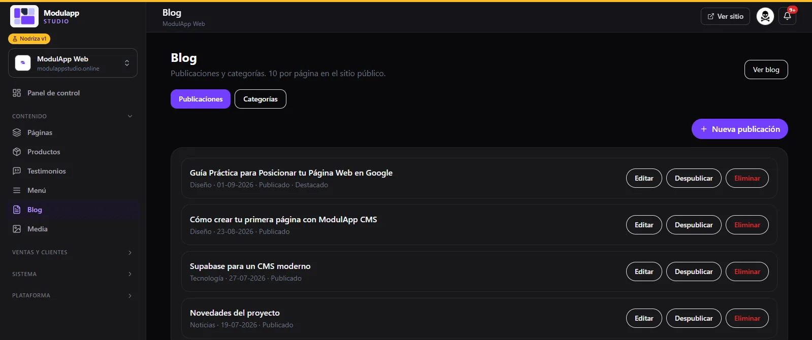
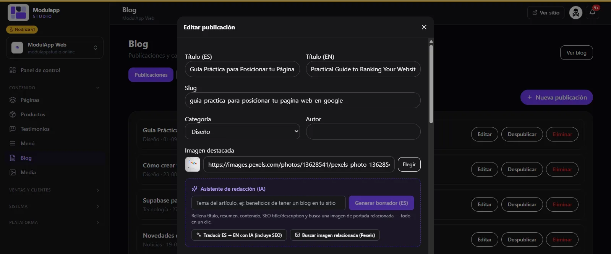
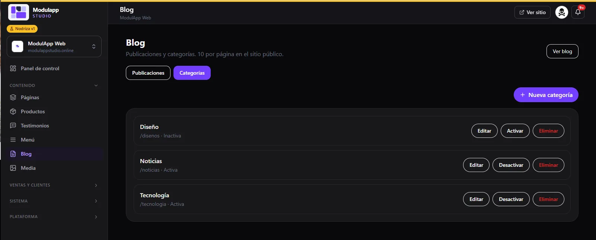

import { Aside, Steps } from '@astrojs/starlight/components';

El blog te ayuda a que Google te encuentre y a atraer clientes con contenido. En **Contenido → Blog** manejas tus **publicaciones** y tus **categorías**.

## Publicaciones

Cada artículo muestra su categoría, su fecha y su estado (**Publicado**, **Destacado**). Tienes tres acciones:

| Botón | Qué hace |
|---|---|
| **Editar** | Abre el artículo para modificarlo. |
| **Despublicar** | Lo oculta del sitio sin borrarlo. |
| **Eliminar** | Lo borra. |

**Nueva publicación** crea un artículo y **Ver blog** abre tu blog público. En el sitio se muestran 10 artículos por página.

## Escribir un artículo

Al crear o editar una publicación completas:

- **Título (ES)** y **Título (EN)**.
- **Slug**: la dirección del artículo.
- **Categoría** y **Autor**.
- **Imagen destacada**: pega una dirección o pulsa **Elegir** para tomarla de [Media](/contenido/media/).

## Asistente de redacción con IA

En el cuadro morado **Asistente de redacción (IA)** puedes generar un borrador en segundos.

<Steps>

1. Escribe el **tema del artículo** (por ejemplo, «beneficios de tener un blog en tu sitio»).
2. Pulsa **Generar borrador (ES)**.
3. El asistente rellena título, resumen, contenido y el título y descripción para buscadores (SEO), y busca una imagen de portada relacionada.
4. Revisa el texto, ajústalo con tu estilo y guarda.

</Steps>

Dos botones más te ahorran trabajo:

- **Traducir ES → EN con IA (incluye SEO)** pasa el artículo al inglés.
- **Buscar imagen relacionada (Pexels)** propone una foto para la portada.

<Aside type="caution">
La IA es un punto de partida. Revisa siempre los datos, los nombres y las promesas antes de publicar.
</Aside>

## Categorías

La pestaña **Categorías** ordena tus artículos.

- **Nueva categoría** crea una.
- **Editar** cambia su nombre.
- **Activar** o **Desactivar** la muestra u oculta en el sitio (una categoría inactiva se ve como «Inactiva»).
- **Eliminar** la borra.
