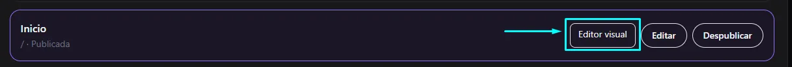
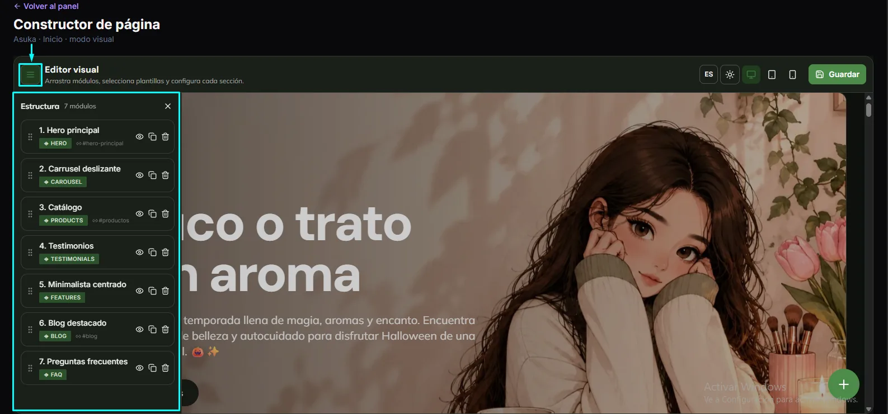
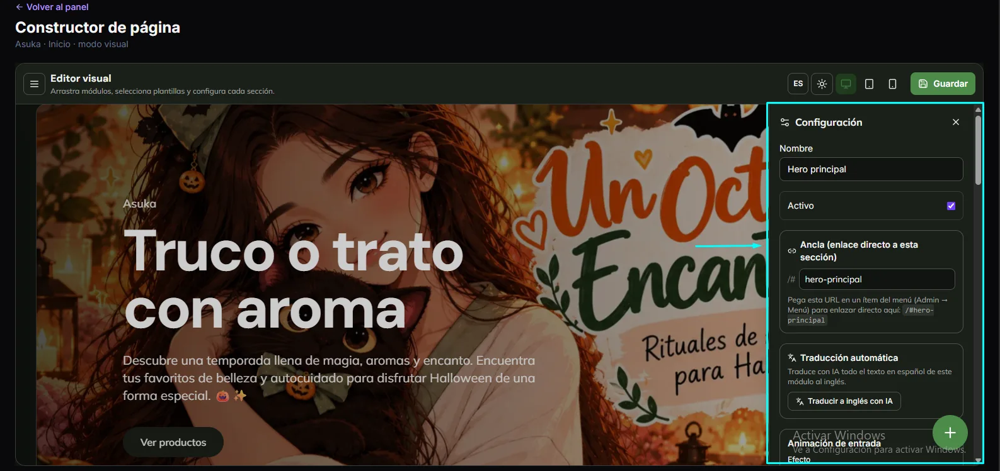
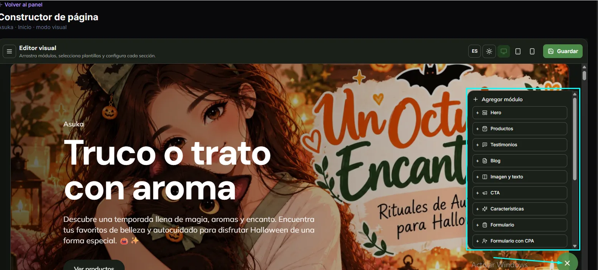

import { Aside, Steps } from '@astrojs/starlight/components';

El editor visual te deja armar cada página con **módulos prediseñados** y ver cómo queda mientras trabajas. Los módulos están pensados para que tu sitio sea rápido, moderno y fácil de encontrar en Google.

## Abrir el editor

<Steps>

1. Ve a **Contenido → Páginas**.
2. En la página que quieras, pulsa **Editor visual**.
3. Se abre el **Constructor de página**, con tu sitio al centro.

</Steps>

En la barra superior del editor encuentras:

- El botón de **menú** (tres rayas), que abre la **Estructura** de la página.
- El selector de **idioma** (ES).
- Las vistas **escritorio, tablet y móvil**, para revisar cómo se ve en cada pantalla.
- **Guardar**.

## Estructura: ordena los módulos

Pulsa el botón de menú para ver la lista de módulos de la página, numerados en orden. Por ejemplo, la página de inicio de un sitio puede tener: Hero principal, Carrusel deslizante, Catálogo, Testimonios, Minimalista centrado, Blog destacado y Preguntas frecuentes.

- **Arrastra** un módulo para cambiarlo de lugar.
- El ícono del **ojo** muestra u oculta el módulo.
- El ícono de **copiar** lo duplica.
- El ícono de **papelera** lo elimina.

## Configurar un módulo

Haz clic en un módulo y se abre el panel **Configuración**:

| Campo | Para qué sirve |
|---|---|
| **Nombre** | Cómo se llama el módulo en la lista de Estructura. |
| **Activo** | Si está desmarcado, el módulo no aparece en el sitio. |
| **Ancla** | Un enlace directo a esa sección. Pega la dirección que muestra (por ejemplo `/#hero-principal`) en un ítem del **Menú** para enlazar directo. |
| **Traducción automática** | **Traducir a inglés con IA** traduce el texto del módulo. |
| **Animación de entrada** | Cómo aparece el módulo al hacer scroll. |

## Agregar un módulo

Pulsa el botón verde **+** (abajo a la derecha). Se abre **Agregar módulo** con la lista disponible: Hero, Productos, Testimonios, Blog, Imagen y texto, CTA, Características, Formulario y Formulario con CPA, entre otros. Desplázate para ver el resto.

<Aside type="tip">
Revisa siempre la vista **móvil** antes de guardar. Muchos de tus visitantes entrarán desde el teléfono.
</Aside>

## Guardar

Pulsa **Guardar** (arriba a la derecha). Los cambios se publican en el sitio de acuerdo con el estado de la página; revisa [Páginas](/contenido/paginas/).
