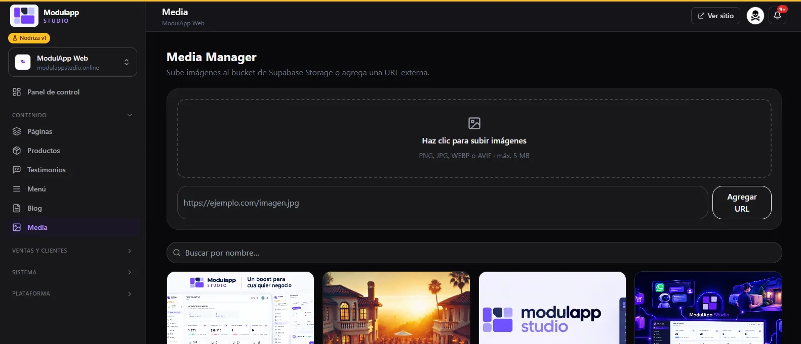

import { Aside } from '@astrojs/starlight/components';

El **Media Manager** (**Contenido → Media**) es la biblioteca de imágenes de tu sitio. Lo que subes aquí lo reutilizas en páginas, productos, blog y correos.

## Subir una imagen

- **Desde tu computador:** haz clic en la zona punteada y elige los archivos. Se aceptan **PNG, JPG, WEBP o AVIF**, de hasta **5 MB** cada uno.
- **Desde una dirección:** pega la dirección de la imagen (por ejemplo `https://ejemplo.com/imagen.jpg`) y pulsa **Agregar URL**.

<Aside type="tip">
Prefiere **WEBP** o **AVIF**: pesan mucho menos que PNG y tu sitio carga más rápido. Además, el almacenamiento tiene un tope según tu [plan](/primeros-pasos/planes-y-limites/).
</Aside>

## Encontrar una imagen

Usa el buscador **Buscar por nombre…** sobre la galería. Las imágenes aparecen como tarjetas.

## Detalle de un archivo

Haz clic en una imagen para abrir **Detalle del archivo**, donde puedes ver y editar:

- **Nombre** del archivo.
- **Descripción**.
- **URL**, con un botón para copiarla.
- **Texto alternativo**, que se arma solo a partir del nombre. Es lo que lee un lector de pantalla y ayuda al posicionamiento en Google.

<Aside type="note">
Las imágenes se guardan en el almacenamiento de tu sitio. Para usarlas en un producto, en el blog o en un módulo, pulsa **Elegir** en el campo de imagen y selecciónala desde aquí.
</Aside>
