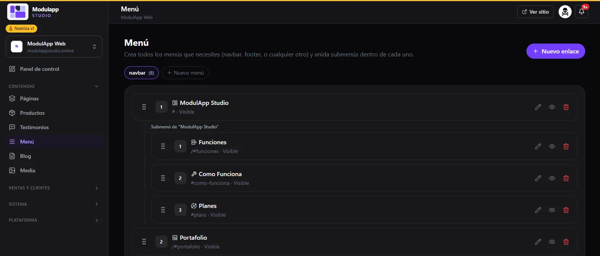
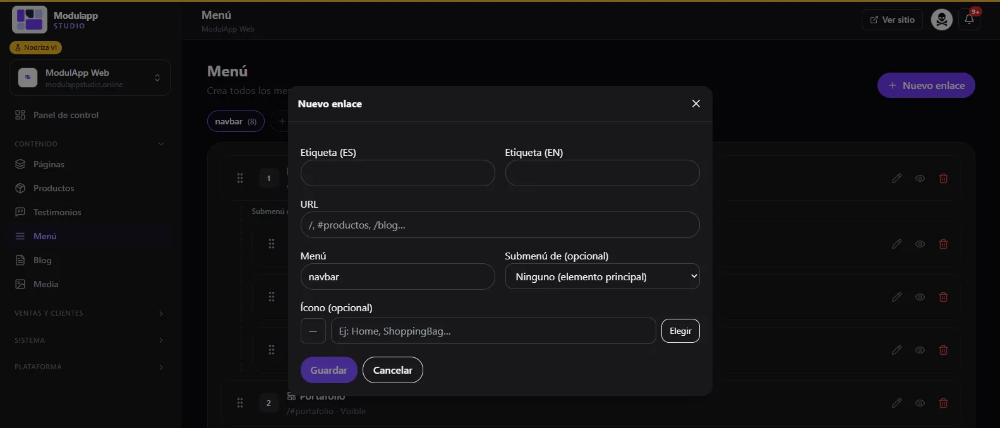
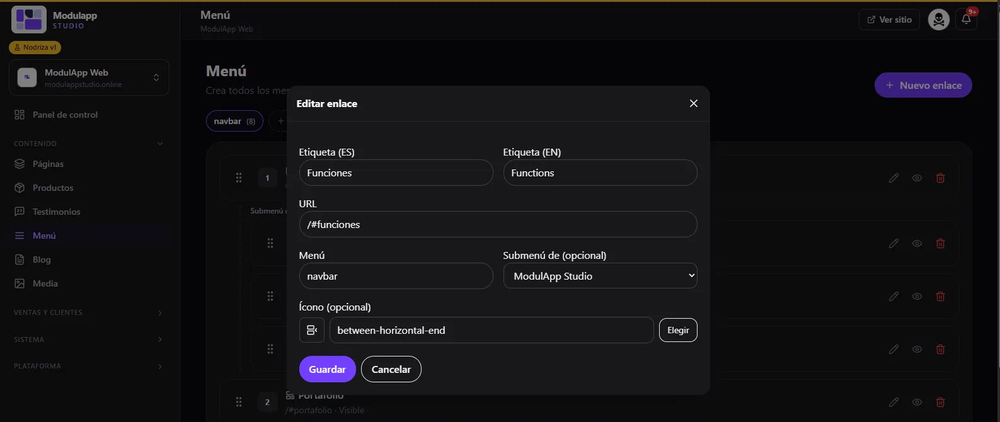

import { Aside, Steps } from '@astrojs/starlight/components';

En **Contenido → Menú** armas los menús de tu sitio: la barra de navegación, el pie de página o cualquier otro, con submenús dentro de cada uno.

## La lista de enlaces

- Arriba hay una pestaña por cada menú (por ejemplo **navbar**, con el número de enlaces). Pulsa **Nuevo menú** para crear otro.
- Cada enlace muestra su **número**, su ícono, su nombre, su dirección y si está **Visible**.
- **Arrastra** un enlace para cambiar su orden.
- A la derecha de cada fila: **editar** (lápiz), **ocultar o mostrar** (ojo) y **eliminar** (papelera).
- Los **submenús** aparecen sangrados debajo de su enlace principal. Por ejemplo, «ModulApp Studio» puede tener debajo Funciones, Cómo funciona y Planes.

## Crear un enlace

<Steps>

1. Pulsa **Nuevo enlace**.
2. Escribe la **Etiqueta (ES)** y la **Etiqueta (EN)**: lo que verá el visitante.
3. En **URL** pon la dirección: `/` para el inicio, `/blog` para una página, o `#productos` para ir a una sección.
4. Elige el **Menú** al que pertenece (por ejemplo, `navbar`).
5. Si debe quedar dentro de otro enlace, elígelo en **Submenú de**. Si es un elemento principal, deja **Ninguno**.
6. Opcional: elige un **Ícono** con **Elegir** o escribiendo su nombre (por ejemplo, `Home` o `ShoppingBag`).
7. Pulsa **Guardar**.

</Steps>

## Editar un enlace

Pulsa el lápiz y cambia lo que necesites. En la captura, el enlace «Funciones» apunta a `/#funciones` y es un submenú de «ModulApp Studio».

<Aside type="tip">
Para llevar al visitante a una sección de una página, usa el **ancla** de ese módulo en el [Editor visual](/contenido/editor-visual/) y pégala en la URL del enlace (por ejemplo `/#hero-principal`).
</Aside>

## Qué menú se muestra en el sitio

El menú que alimenta la barra superior se elige en [Configuración → Navbar y Footer](/sistema/configuracion/). Allí también defines qué menús aparecen como columnas del pie de página.
