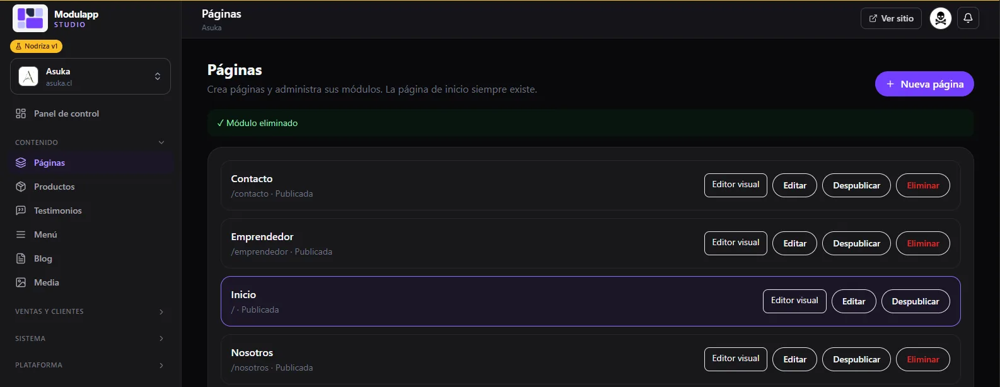
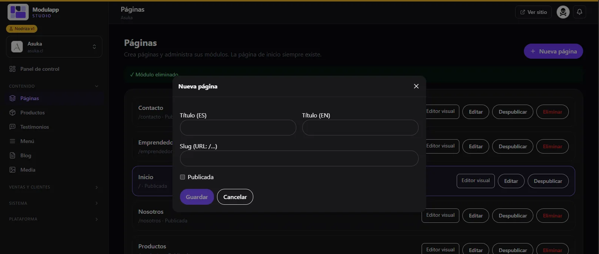
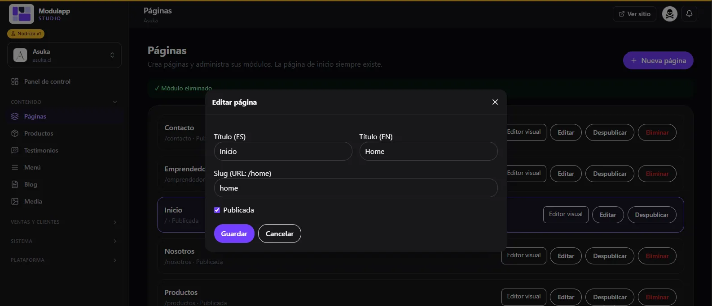

import { Aside } from '@astrojs/starlight/components';

En **Contenido → Páginas** administras todas las páginas de tu sitio. La página de inicio siempre existe.

Cada página muestra su dirección web y su estado (por ejemplo, `/contacto · Publicada`). A la derecha tiene cuatro acciones:

| Botón | Qué hace |
|---|---|
| **Editor visual** | Abre la página para armarla con módulos. Ver [Editor visual](/contenido/editor-visual/). |
| **Editar** | Cambia el título, la dirección y el estado. |
| **Despublicar** | Oculta la página del sitio público sin borrarla. |
| **Eliminar** | Borra la página. La página de inicio no se puede eliminar. |

## Crear una página nueva

1. Pulsa **Nueva página**, arriba a la derecha.
2. Escribe el **Título (ES)** y el **Título (EN)**.
3. Define el **Slug**: es la dirección de la página (`/contacto`, `/nosotros`).
4. Marca **Publicada** si quieres que se vea de inmediato.
5. Pulsa **Guardar**.

<Aside type="tip">
Deja **Publicada** sin marcar mientras armas la página. Así la revisas con calma y la publicas cuando esté lista.
</Aside>

## Editar los datos de una página

Pulsa **Editar** en la página que quieras cambiar. Verás los mismos campos: títulos en español e inglés, slug y el interruptor **Publicada**.

Para cambiar el contenido de la página, usa el **Editor visual**.
