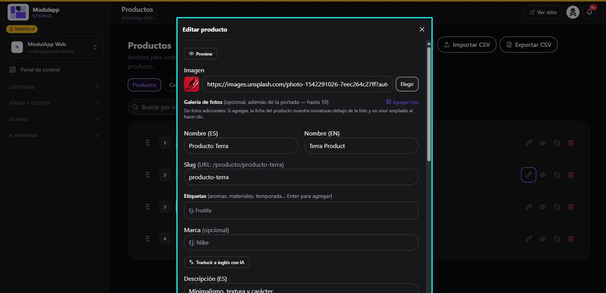

import { Aside } from '@astrojs/starlight/components';

En **Contenido → Productos** administras tu catálogo.

## La lista de productos

- Cada producto aparece numerado. **Arrástralo** para cambiar el orden en que se muestra.
- Al final de cada fila tienes: **editar** (lápiz), **ver** (ojo), **duplicar** y **eliminar**.
- Arriba hay un buscador por nombre y los botones **Importar CSV** y **Exportar CSV**.

<Aside type="tip">
Si ya tienes tu inventario en una planilla, usa **Importar CSV** para cargarlo de una vez. **Exportar CSV** te sirve de respaldo.
</Aside>

## Editar un producto

Pulsa el lápiz del producto. Se abre la ventana **Editar producto**:

| Campo | Qué poner |
|---|---|
| **Preview** | Muestra cómo se verá el producto en el sitio. |
| **Imagen** | La foto de portada. Pega una dirección o pulsa **Elegir** para tomarla de tu biblioteca de Media. |
| **Galería de fotos** | Opcional: hasta 10 fotos más. Si agregas, la ficha del producto muestra miniaturas debajo de la foto y un visor ampliado al hacer clic. |
| **Nombre (ES) / (EN)** | El nombre en español e inglés. |
| **Slug** | La dirección del producto: `/producto/producto-terra`. |
| **Etiquetas** | Aromas, materiales, temporada… Presiona Enter para agregar cada una. |
| **Marca** | Opcional. |
| **Descripción (ES)** | El texto del producto. Más abajo está la versión en inglés. |

### Traducir con IA

Escribe el nombre y la descripción en español y pulsa **Traducir a inglés con IA**. Revisa el resultado antes de guardar.

<Aside type="note">
Esta guía cubre los campos principales. Los campos de precio, stock y variantes se documentarán en una próxima versión.
</Aside>
