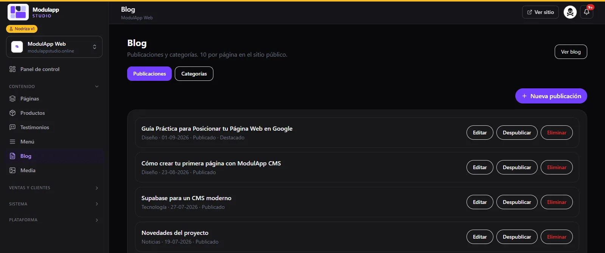
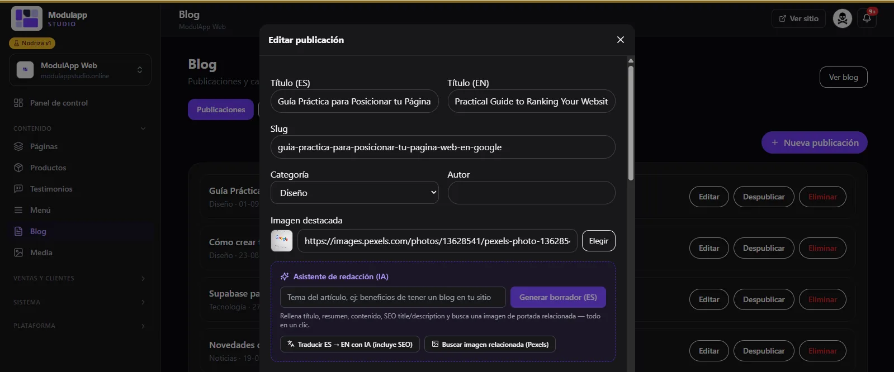
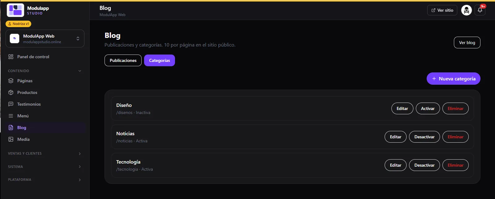

import { Aside, Steps } from '@astrojs/starlight/components';

The blog helps Google find you and attracts customers with content. Under **Content → Blog** you manage your **posts** and your **categories**.

## Posts

Each article shows its category, its date and its status (**Published**, **Featured**). You have three actions:

| Button | What it does |
|---|---|
| **Edit** | Opens the article to modify it. |
| **Unpublish** | Hides it from the site without deleting it. |
| **Delete** | Deletes it. |

**New post** creates an article and **View blog** opens your public blog. The site shows 10 articles per page.

## Write an article

When you create or edit a post you fill in:

- **Title (ES)** and **Title (EN)**.
- **Slug**: the article's address.
- **Category** and **Author**.
- **Featured image**: paste an address or click **Choose** to take it from [Media](/en/contenido/media/).

## AI writing assistant

In the purple **Writing assistant (AI)** box you can generate a draft in seconds.

<Steps>

1. Type the **article topic** (for example, "benefits of having a blog on your site").
2. Click **Generate draft (ES)**.
3. The assistant fills in the title, summary, content and the search-engine title and description (SEO), and looks for a related cover image.
4. Review the text, adjust it to your style and save.

</Steps>

Two more buttons save you work:

- **Translate ES → EN with AI (includes SEO)** turns the article into English.
- **Find related image (Pexels)** suggests a photo for the cover.

<Aside type="caution">
AI is a starting point. Always check facts, names and promises before publishing.
</Aside>

## Categories

The **Categories** tab keeps your articles organized.

- **New category** creates one.
- **Edit** changes its name.
- **Activate** or **Deactivate** shows or hides it on the site (an inactive category shows as "Inactive").
- **Delete** removes it.
