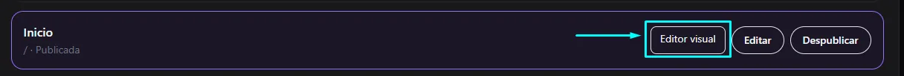
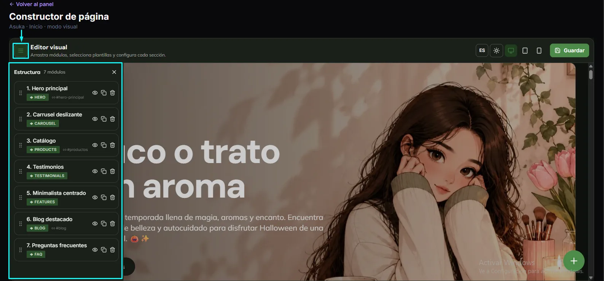
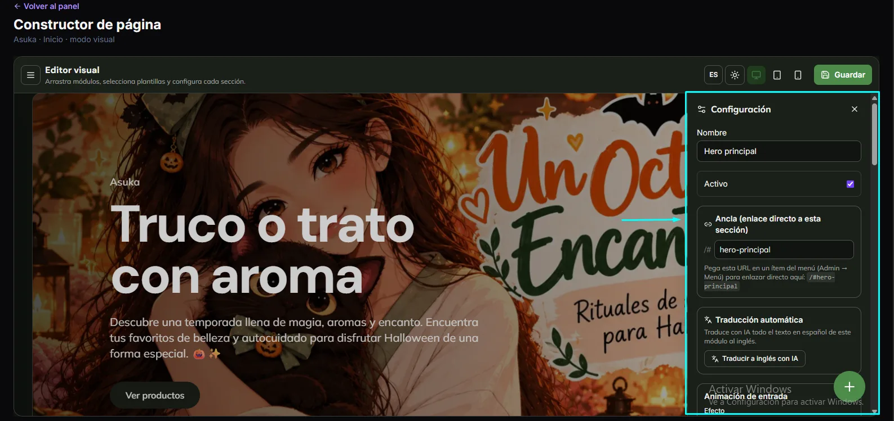
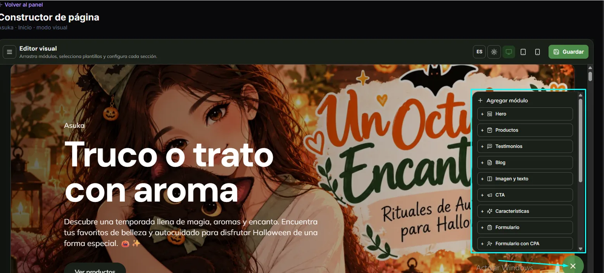

import { Aside, Steps } from '@astrojs/starlight/components';

The visual editor lets you build each page with **ready-made modules** and see how it looks while you work. The modules are designed so your site is fast, modern and easy to find on Google.

## Open the editor

<Steps>

1. Go to **Content → Pages**.
2. On the page you want, click **Visual editor**.
3. The **Page builder** opens, with your site in the middle.

</Steps>

In the editor's top bar you will find:

- The **menu** button (three lines), which opens the page **Structure**.
- The **language** selector (ES).
- The **desktop, tablet and mobile** views, to check how it looks on each screen.
- **Save**.

## Structure: order the modules

Click the menu button to see the page's list of modules, numbered in order. For example, a site's home page may have: Main hero, Sliding carousel, Catalog, Testimonials, Centered minimalist, Featured blog and Frequently asked questions.

- **Drag** a module to move it.
- The **eye** icon shows or hides the module.
- The **copy** icon duplicates it.
- The **trash** icon deletes it.

## Configure a module

Click a module and the **Settings** panel opens:

| Field | What it is for |
|---|---|
| **Name** | What the module is called in the Structure list. |
| **Active** | If unticked, the module does not appear on the site. |
| **Anchor** | A direct link to that section. Paste the address shown (for example `/#hero-principal`) into an item of the **Menu** to link straight to it. |
| **Automatic translation** | **Translate to English with AI** translates the module's text. |
| **Entrance animation** | How the module appears as you scroll. |

## Add a module

Click the green **+** button (bottom right). **Add module** opens with the available list: Hero, Products, Testimonials, Blog, Image and text, CTA, Features, Form and Form with CPA, among others. Scroll to see the rest.

<Aside type="tip">
Always check the **mobile** view before saving. Many of your visitors will come from their phones.
</Aside>

## Save

Click **Save** (top right). Changes go live on the site according to the page status; see [Pages](/en/contenido/paginas/).
