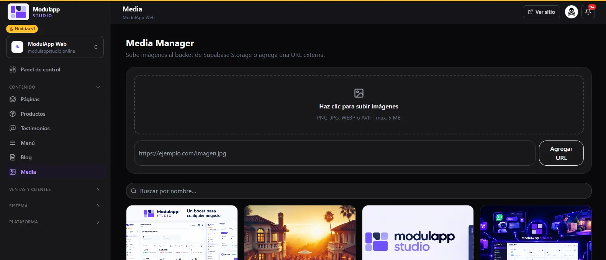

import { Aside } from '@astrojs/starlight/components';

The **Media Manager** (**Content → Media**) is your site's image library. What you upload here you can reuse in pages, products, blog and emails.

## Upload an image

- **From your computer:** click the dotted area and choose your files. **PNG, JPG, WEBP or AVIF** are accepted, up to **5 MB** each.
- **From an address:** paste the image address (for example `https://example.com/image.jpg`) and click **Add URL**.

<Aside type="tip">
Prefer **WEBP** or **AVIF**: they weigh much less than PNG and your site loads faster. Storage also has a cap depending on your [plan](/en/primeros-pasos/planes-y-limites/).
</Aside>

## Find an image

Use the **Search by name…** box above the gallery. Images appear as cards.

## File details

Click an image to open **File details**, where you can see and edit:

- The file **Name**.
- **Description**.
- **URL**, with a button to copy it.
- **Alt text**, which is built from the name automatically. It is what a screen reader reads and it helps your ranking on Google.

<Aside type="note">
Images are stored in your site's storage. To use one in a product, in the blog or in a module, click **Choose** in the image field and select it from here.
</Aside>
