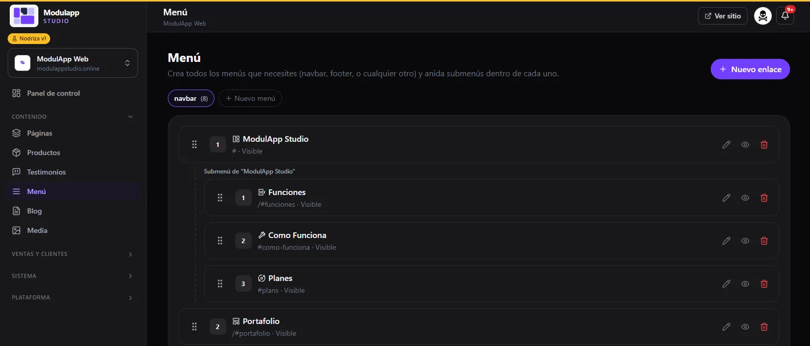
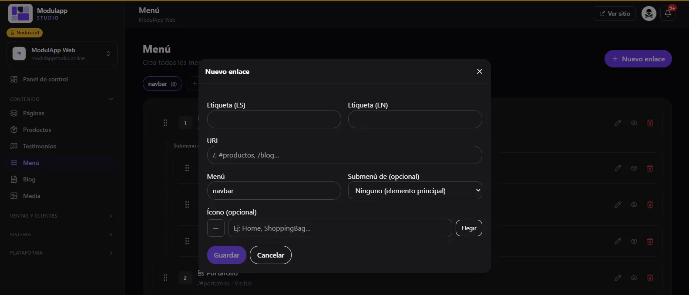
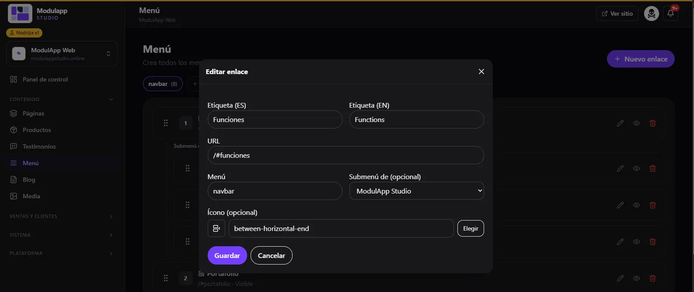

import { Aside, Steps } from '@astrojs/starlight/components';

Under **Content → Menu** you build your site's menus: the navigation bar, the footer or any other, with submenus inside each one.

## The link list

- At the top there is a tab for each menu (for example **navbar**, with the number of links). Click **New menu** to create another.
- Each link shows its **number**, its icon, its name, its address and whether it is **Visible**.
- **Drag** a link to change its order.
- On the right of each row: **edit** (pencil), **hide or show** (eye) and **delete** (trash).
- **Submenus** appear indented below their main link. For example, "ModulApp Studio" can have Features, How it works and Plans below it.

## Create a link

<Steps>

1. Click **New link**.
2. Type the **Label (ES)** and the **Label (EN)**: what the visitor will see.
3. In **URL** enter the address: `/` for the home page, `/blog` for a page, or `#productos` to jump to a section.
4. Choose the **Menu** it belongs to (for example, `navbar`).
5. If it should sit inside another link, choose it in **Submenu of**. If it is a main item, leave **None**.
6. Optional: choose an **Icon** with **Choose** or by typing its name (for example, `Home` or `ShoppingBag`).
7. Click **Save**.

</Steps>

## Edit a link

Click the pencil and change what you need. In the screenshot, the "Functions" link points to `/#funciones` and is a submenu of "ModulApp Studio".

<Aside type="tip">
To send the visitor to a section of a page, use that module's **anchor** in the [Visual editor](/en/contenido/editor-visual/) and paste it into the link's URL (for example `/#hero-principal`).
</Aside>

## Which menu shows on the site

The menu that feeds the top bar is chosen in [Settings → Navbar and Footer](/en/sistema/configuracion/). There you also define which menus appear as columns in the footer.
