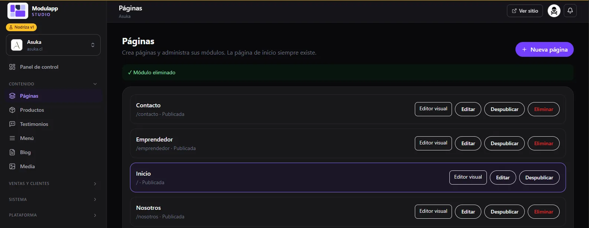
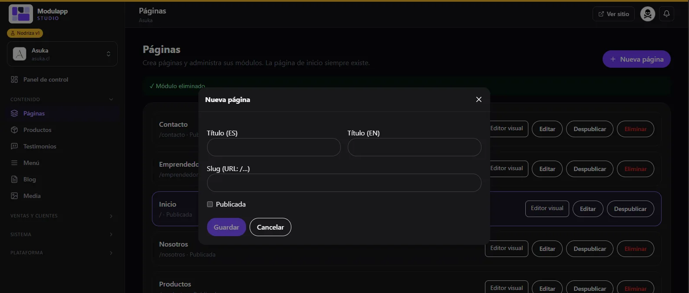
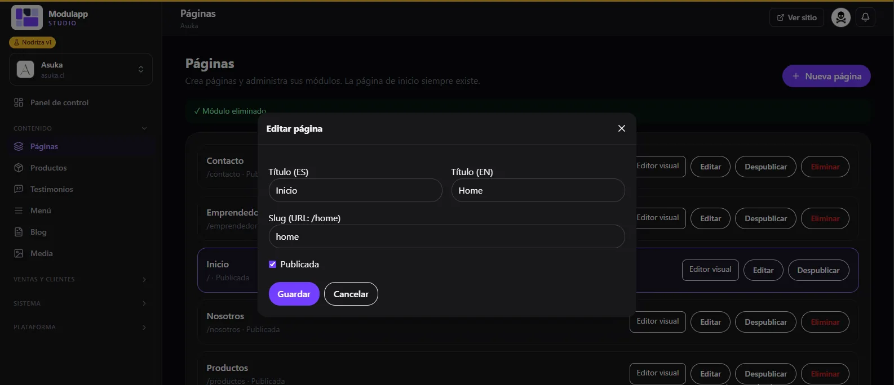

import { Aside } from '@astrojs/starlight/components';

Under **Content → Pages** you manage all the pages of your site. The home page always exists.

Each page shows its web address and its status (for example, `/contacto · Published`). On the right it has four actions:

| Button | What it does |
|---|---|
| **Visual editor** | Opens the page so you can build it with modules. See [Visual editor](/en/contenido/editor-visual/). |
| **Edit** | Changes the title, the address and the status. |
| **Unpublish** | Hides the page from the public site without deleting it. |
| **Delete** | Deletes the page. The home page cannot be deleted. |

## Create a new page

1. Click **New page**, at the top right.
2. Type the **Title (ES)** and the **Title (EN)**.
3. Set the **Slug**: it is the page's address (`/contact`, `/about`).
4. Tick **Published** if you want it to go live right away.
5. Click **Save**.

<Aside type="tip">
Leave **Published** unticked while you build the page. That way you can review it calmly and publish it when it is ready.
</Aside>

## Edit a page's details

Click **Edit** on the page you want to change. You will see the same fields: titles in Spanish and English, slug and the **Published** switch.

To change what is on the page, use the **Visual editor**.
