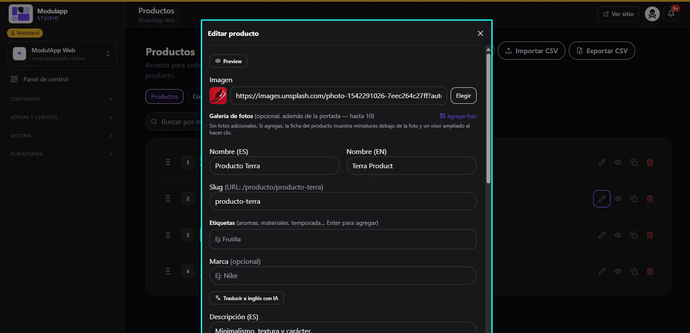

import { Aside } from '@astrojs/starlight/components';

Under **Content → Products** you manage your catalog.

## The product list

- Each product is numbered. **Drag** it to change the order in which it is shown.
- At the end of each row you have: **edit** (pencil), **view** (eye), **duplicate** and **delete**.
- At the top there is a search by name and the **Import CSV** and **Export CSV** buttons.

<Aside type="tip">
If you already have your inventory in a spreadsheet, use **Import CSV** to load it all at once. **Export CSV** serves as a backup.
</Aside>

## Edit a product

Click the product's pencil. The **Edit product** window opens:

| Field | What to enter |
|---|---|
| **Preview** | Shows how the product will look on the site. |
| **Image** | The cover photo. Paste an address or click **Choose** to pick it from your Media library. |
| **Photo gallery** | Optional: up to 10 more photos. If you add some, the product page shows thumbnails under the photo and an enlarged viewer on click. |
| **Name (ES) / (EN)** | The name in Spanish and English. |
| **Slug** | The product's address: `/producto/producto-terra`. |
| **Tags** | Aromas, materials, season… Press Enter to add each one. |
| **Brand** | Optional. |
| **Description (ES)** | The product text. The English version is below it. |

### Translate with AI

Write the name and description in Spanish and click **Translate to English with AI**. Check the result before saving.

<Aside type="note">
This guide covers the main fields. Price, stock and variant fields will be documented in a later version.
</Aside>
