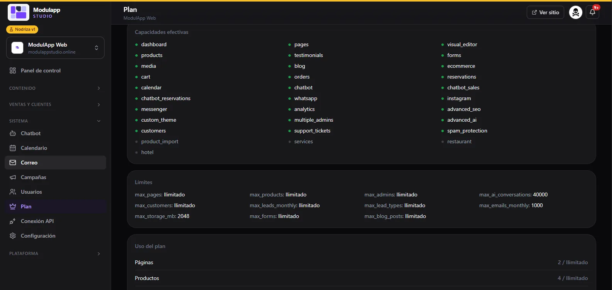

import { Aside } from '@astrojs/starlight/components';

Under **System → Plan** you see what you can use on your site and how much you have consumed.

## Effective capabilities

This is the list of platform modules. Those shown **in green are included** in your plan; **gray ones are not**. Included ones are, for example: dashboard, pages, products, testimonials, blog, media, orders, cart, visual editor, forms, store, bookings, calendar, chatbot with bookings and sales, WhatsApp, Instagram, Messenger, analytics, advanced SEO, advanced AI, customers, support tickets and spam protection.

<Aside type="note">
Names appear in technical English (`visual_editor`, `chatbot_sales`…). That is how the panel shows them.
</Aside>

## Limits

Your plan's caps. In the example in the screenshot:

| Limit | What it measures | Example value |
|---|---|---|
| `max_pages`, `max_products`, `max_admins`, `max_customers`, `max_forms`, `max_blog_posts` | Pages, products, administrators, customers, forms and blog articles | Unlimited |
| `max_leads_monthly`, `max_lead_types` | Leads received per month and lead form types | Unlimited |
| `max_ai_conversations` | AI conversations | 40,000 |
| `max_emails_monthly` | Emails sent per month | 1,000 |
| `max_storage_mb` | Image storage (Media) | 2,048 MB (2 GB) |

Values depend on your plan.

## Plan usage

Further down, **Plan usage** compares what you have with your limit (for example, "Pages 2 / Unlimited"). It is the same information the bars on the [Dashboard](/en/primeros-pasos/panel-de-control/) show.
