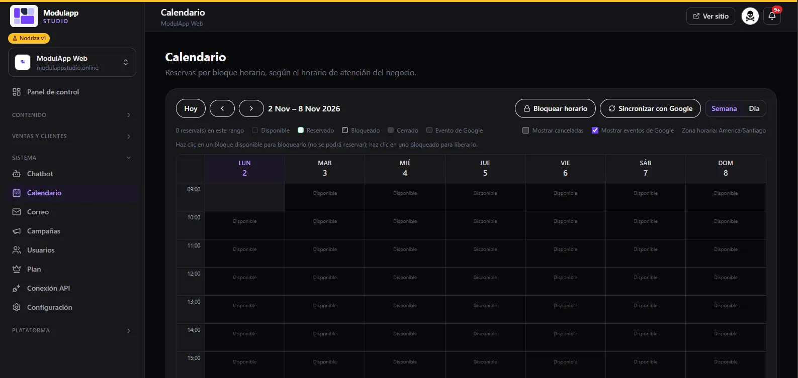

import { Aside } from '@astrojs/starlight/components';

Under **System → Calendar** you see bookings by **time slot**, according to your business hours.

## Move around the calendar

- **Today** goes back to the current date and the arrows change the week.
- **Week** and **Day** switch the view.
- The **time zone** in use appears at the top right.

## Status of each slot

Each one-hour slot has a status, shown in the legend at the top:

| Status | Meaning |
|---|---|
| **Available** | It can be booked. |
| **Booked** | It already has a booking. |
| **Blocked** | You blocked it: nobody can book it. |
| **Closed** | Outside business hours. |
| **Google event** | It comes from your Google Calendar. |

Tick **Show cancelled** to also see cancelled bookings, and **Show Google events** to see the events from your Google calendar.

## Block and release hours

- Click an **available** slot to **block it**: it can no longer be booked.
- Click a **blocked** slot to **release it**.
- **Block hours** helps you close several hours at once.

## Sync with Google

**Sync with Google** brings in your events and sends bookings to your Google Calendar. To turn it on, set up the connection in [Chatbot → Google Calendar](/en/sistema/chatbot/).

<Aside type="tip">
Bookings reach the calendar from the [Chatbot](/en/sistema/chatbot/) and from booking [forms](/en/ventas/formularios/).
</Aside>
