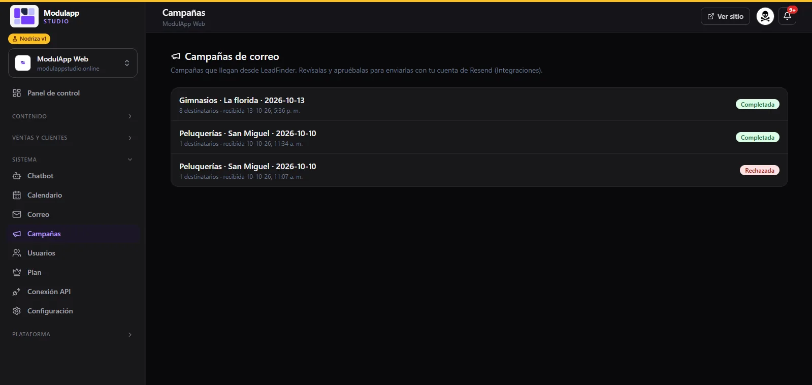

import { Aside } from '@astrojs/starlight/components';

**System → Campaigns** gathers the **email campaigns that arrive from LeadFinder**, the tool that finds businesses and prepares the messages. You review them and approve them to send them with your own Resend account.

## What the list shows

Each campaign shows:

- Its **name**: usually the industry, the area and the date (for example, "Gyms · La Florida · 2026-10-13").
- The number of **recipients** and when it was received.
- Its **status**: **Completed** if it has been sent, or **Rejected** if you did not approve it.

## The whole flow

1. In LeadFinder you search for businesses in an industry and an area, and prepare the campaign.
2. The campaign arrives here, in your panel.
3. You **review and approve it** (or reject it). Nothing is sent without your approval.
4. Once approved, it is sent with your Resend account.

<Aside type="caution">
Before emailing people who do not know you, check that you comply with data protection rules and that every email includes a clear way to stop receiving them.
</Aside>

For sending to work, connect your account in [Settings → Integrations](/en/sistema/configuracion/).
