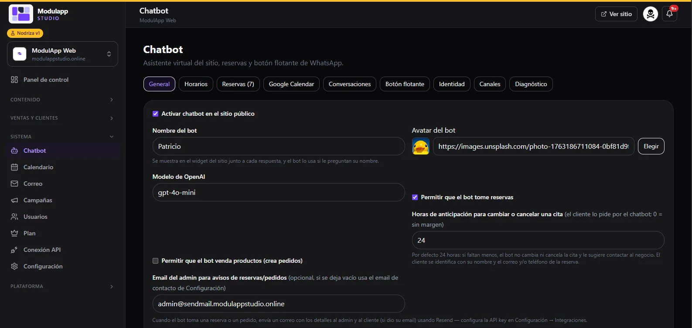
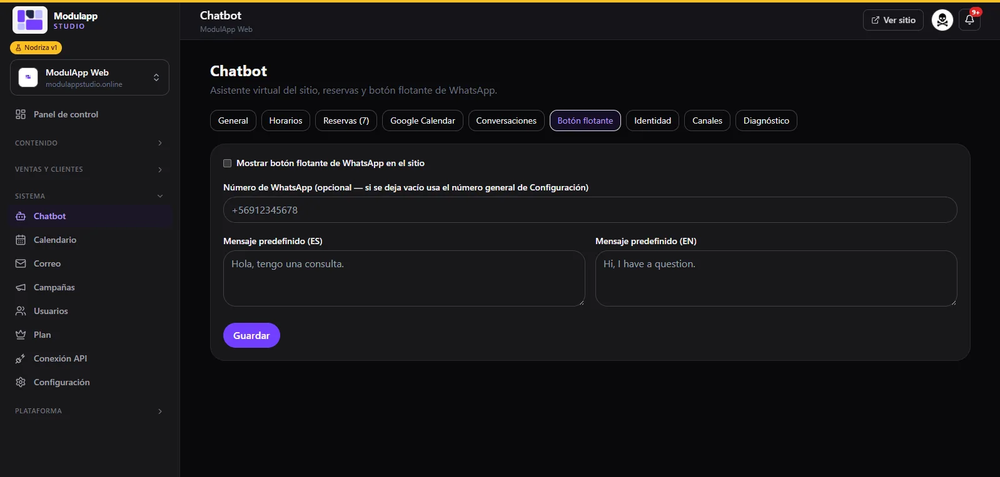

import { Aside } from '@astrojs/starlight/components';

The chatbot is your **site's virtual assistant**. It serves your visitors, can take bookings and, if you turn it on, create orders. You set it up under **System → Chatbot**.

At the top you will see the tabs: **General, Hours, Bookings, Google Calendar, Conversations, Floating button, Identity, Channels and Diagnostics**.

## General

| Option | What it is for |
|---|---|
| **Enable chatbot on the public site** | Shows or hides the chat on your site. |
| **Bot name** | The name your visitors see next to each answer. |
| **Bot avatar** | The assistant's image. Paste an address or click **Choose**. |
| **OpenAI model** | The AI model that answers. |
| **Allow the bot to take bookings** | The assistant can schedule appointments. |
| **Notice hours** | How many hours ahead a customer can change or cancel an appointment from the chat (24 by default; `0` = no margin). |
| **Allow the bot to sell products** | The assistant can create orders. |
| **Admin email for alerts** | Where booking and order alerts reach you. If left empty, it uses the contact email from Settings. |

## Bookings

It lists all the bookings the chatbot has taken, with date, time, contact and status (**Pending**, **Completed**…). Synced bookings are marked **Synced with Google Calendar**.

## Google Calendar

Sync bookings with your Google Calendar.

1. Tick **Enable Google Calendar sync**.
2. Paste the **calendar ID**.
3. Paste the **Google service account JSON**.
4. **Share your calendar** with that service account's email, with the "Make changes to events" permission.
5. Click **Save** and then **Test connection**. You will see "Connected to…" if all is well.

<Aside type="caution">
The service account JSON is stored only in the panel and is never sent to the public site. Do not share it with anyone.
</Aside>

The **Email the customer** option adds the customer as a guest of the event (with a 10-minute reminder) and sends them a confirmation email. Turn it off while you test so you do not notify anyone real.

## Conversations

Here you see each of your visitors' conversations. Open one to read the messages. From there you can:

- Turn **Automatic replies (AI)** on or off for that conversation.
- **Convert into a customer**: add their name and email and they are registered in your customer list.

## Floating WhatsApp button

1. Tick **Show floating WhatsApp button on the site**.
2. Type the **WhatsApp number** with the country code (for example `+56912345678`). If left empty, it uses the general number from Settings.
3. Type the **default message** in Spanish and English.
4. Click **Save**.

<Aside type="note">
The Hours, Identity, Channels and Diagnostics tabs will be documented in a later version.
</Aside>
