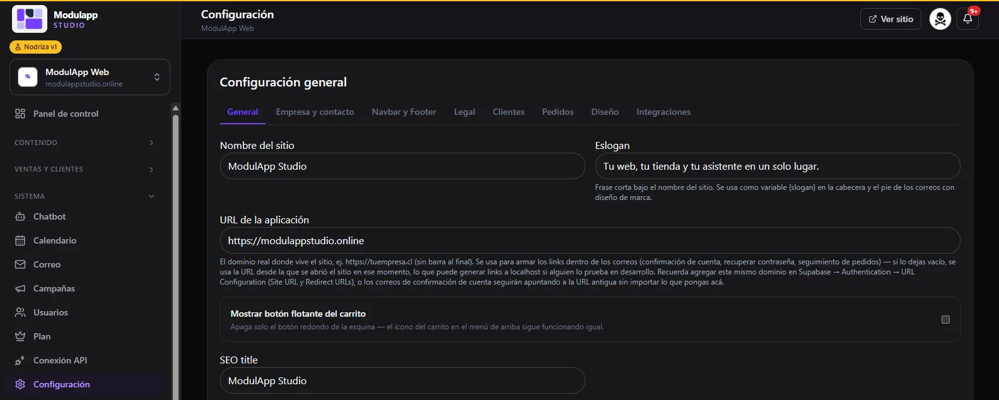
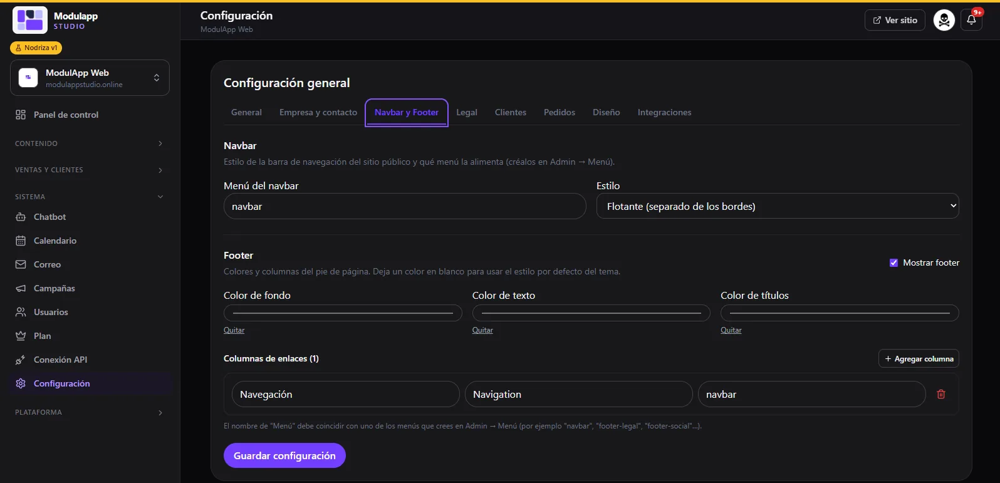
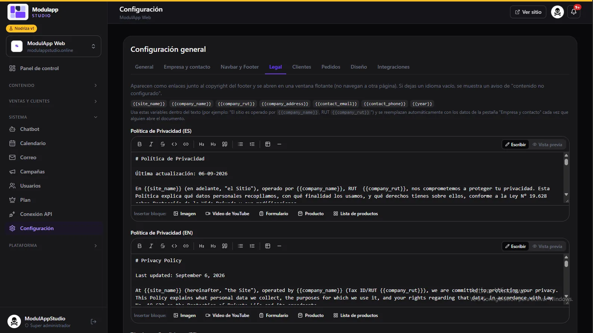
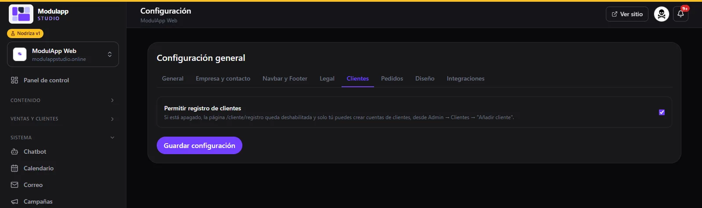
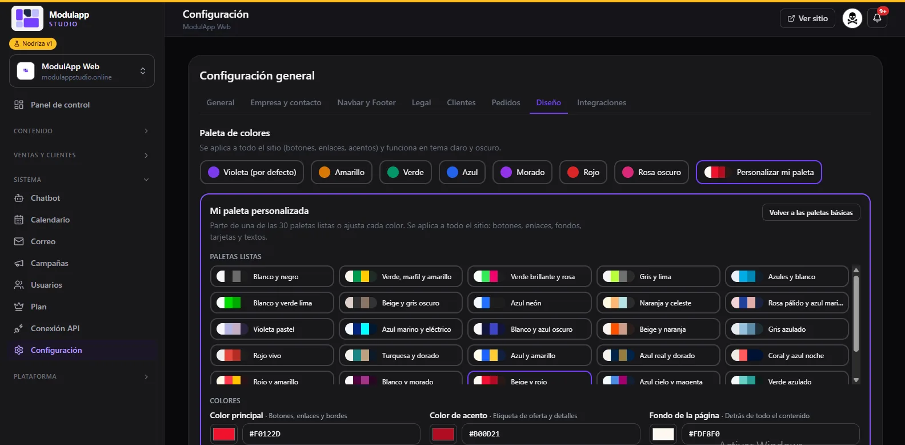

import { Aside } from '@astrojs/starlight/components';

Under **System → Settings** you tailor your site. It is organized in tabs: **General, Company and contact, Navbar and Footer, Legal, Customers, Orders, Design** and **Integrations**. Remember to click **Save settings** when you finish.

## General

- **Site name** and **Slogan**. The slogan is the short phrase under the name and is also used in the header and footer of your emails.
- **App URL:** your site's real domain (for example `https://yourcompany.com`, no trailing slash). It is used to build the links inside emails.
- **Show floating cart button:** turns off only the round button in the corner; the cart icon in the menu keeps working.
- **SEO title** and the rest of the search-engine data.

## Company and contact

Your **WhatsApp**, **phone** and **contact email**, and the **company details** (legal name, tax ID and address). These details are used as variables in the legal texts, and there is also a block for your bank transfer details.

## Navbar and Footer

- **Navbar:** choose which menu feeds the top bar (you create them in [Menu](/en/contenido/menu/)) and its **style**, for example floating and set apart from the edges.
- **Footer:** show or hide the footer, set the background, text and title **colors** (leave them blank to use the theme style) and add **link columns**: each one with a name in Spanish and English and the menu it shows.

## Legal

Here you write your **Privacy Policy** and your **Terms and Conditions**, in Spanish and English. They appear as links next to the copyright and open in a pop-up window.

Texts are written with a simple editor (Markdown) and accept **variables** that are replaced automatically with your company data: `{{site_name}}`, `{{company_name}}`, `{{company_rut}}`, `{{company_address}}`, `{{contact_email}}`, `{{contact_phone}}` and `{{year}}`. You can also insert image, YouTube video, form, product or product list blocks.

<Aside type="caution">
Check that your legal texts are right for your business. The templates the panel offers are a starting point, not legal advice.
</Aside>

## Customers

**Allow customer sign-up** turns sign-up on your site on or off. If you turn it off, the sign-up page is disabled and only you can create accounts from [Customers](/en/ventas/clientes/). See also the [Customer portal](/en/ventas/portal-del-cliente/).

## Design

The **color palette** applies to the whole site (buttons, links, accents) and works in light and dark themes.

- Choose a basic palette: **Violet** (default), **Yellow**, **Green**, **Blue**, **Purple**, **Red** or **Dark pink**.
- Or click **Customize my palette**: start from one of the 30 ready-made palettes or adjust each color: **main** (buttons, links and borders), **accent** (offer labels and details) and **background**.

## Integrations

Here you connect external services. Keys are stored in a place only an administrator can read and are **never shown on the public site**. If one is already saved, you will see "saved — type to replace it".

| Integration | What it is for |
|---|---|
| **Resend API key** and **Sender email** | Send order, booking and campaign emails. The sender must be verified in your Resend account. |
| **Inbound email (Resend Inbound)** | Receive in your [Email](/en/sistema/correo/) inbox the messages that reach your addresses. |
| **Pexels API key** | Optional: search photos from the [blog](/en/contenido/blog/). |

<Aside type="note">
Artificial intelligence (OpenAI) is provided by the platform: **you do not need to set up your own key**.
</Aside>

The **Orders** tab will be documented in a later version.
