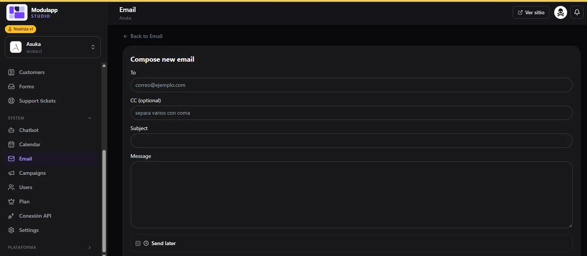

import { Aside, Steps } from '@astrojs/starlight/components';

Under **System → Email** you handle your business email without leaving the panel. It works with **Resend**: emails that reach your addresses appear in your inbox.

The tabs are **Received**, **Sent**, **Scheduled**, **Deleted** and **Settings**.

## Received and sent

- **Received** lists the emails with sender, subject, a preview and the date. The purple dot marks the ones you have not read and the trash can deletes an email. The refresh button reloads the inbox.
- **Sent** shows what you have sent, with recipient, subject and date.
- **Scheduled** are the ones you left to send later.

## Compose an email

<Steps>

1. Click **Compose new email**, at the top right.
2. Type the recipient in **To**. You can add **CC** (optional); separate several addresses with a comma.
3. Fill in **Subject** and **Message**.
4. If you want to send it later, tick **Send later** and choose when.
5. Send the email.

</Steps>

## Automatic emails (Settings)

The **Settings** tab customizes the emails the system sends on its own. You can write the content in HTML and insert images (logo, header) from [Media](/en/contenido/media/).

**Branded design.** The **Use the branded HTML design in emails** switch wraps every email in a header and footer with your style. If something goes wrong, turn it off to send plain, unstyled emails.

**Header image.** Optional: it is added at the top of all emails.

There is a box for each type of email, with **subject**, **message (HTML)** and **preview**:

| Email | When it is sent |
|---|---|
| **Tracking** | When the order moves to "Processing". It includes the customer number and a link to check the status. |
| **Thank-you** | When the order is marked as completed. It can include a link, for example to leave a Google review. |
| **Order paid** | When a payment through Webpay, PayPal or TUU is confirmed, with the administrators in copy. |

### Variables

Inside the subject and the message you can use these variables, which are replaced automatically:

| Variable | What it puts |
|---|---|
| `{{customer_name}}` | Customer name. |
| `{{customer_number}}` | Customer number. |
| `{{tracking_code}}` | The order's tracking code. |
| `{{link}}` | The configured link, or the order tracking link if you leave it empty. |
| `{{shipping_link}}` | The courier link; it is filled in once you save the tracking number in [Orders](/en/ventas/pedidos/). |
| `{{site_name}}` | Your site's name. |

<Aside type="tip">
Write the text first and always check the **preview**, which shows how your customer will see it.
</Aside>

The Resend account and the sender email are configured in [Settings → Integrations](/en/sistema/configuracion/).
