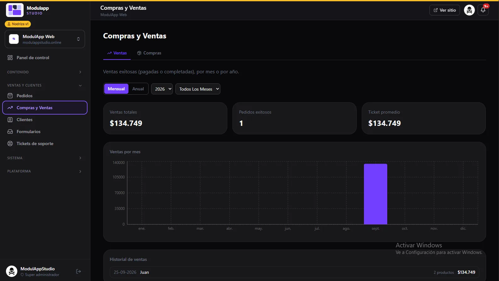
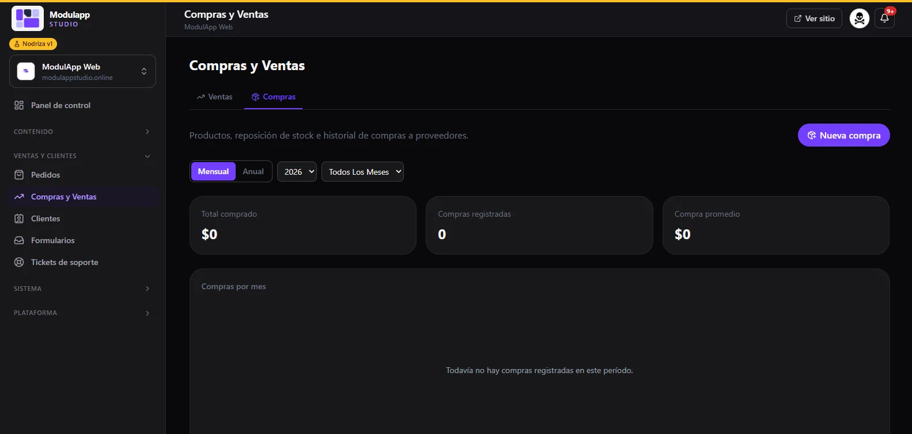

import { Aside } from '@astrojs/starlight/components';

**Sales and customers → Purchases & Sales** brings together the money coming in and going out. It has two tabs: **Sales** and **Purchases**.

## Sales

It shows **successful sales** (paid or completed).

- Choose the **Monthly** or **Yearly** view, the year and the month.
- Three cards sum up the period: **Total sales**, **Successful orders** and **Average ticket**.
- The **Sales by month** chart shows how much you sold each month.
- The **Sales history** lists each sale with its date, customer, number of products and amount.

## Purchases

Here you keep track of **stock replenishment** and what you buy from your suppliers.

- Click **New purchase** to record one.
- Three cards show the **Total purchased**, the **Registered purchases** and the **Average purchase**.
- The **Purchases by month** chart and the history fill up as you record purchases. If there are none in the period, you will see "No purchases recorded in this period yet".

<Aside type="tip">
Recording your purchases lets you see how much comes in and how much goes out in the same place. The latest activity from both tabs also appears on the [Dashboard](/en/primeros-pasos/panel-de-control/).
</Aside>
