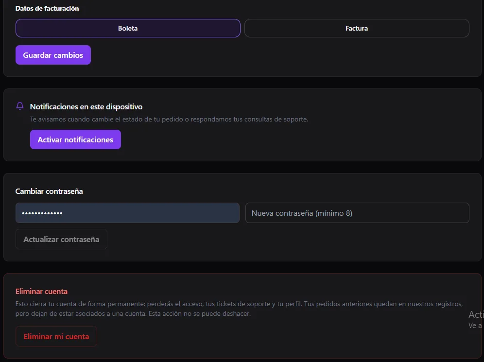

import { Aside } from '@astrojs/starlight/components';

Your customers can have **their own account on your site**. There they check their orders and their status, and manage their details. This page explains what they see.

<Aside type="note">
The portal lives on your public site, not in the panel. See [Customers](/en/ventas/clientes/) to manage them from the panel.
</Aside>

## My account

When they log in, the customer lands on **My account**, with these tabs: **My profile**, **My orders**, **Venue orders**, **My appointments**, **My forms** and **Support**.

### My profile

- **Full name**, **email** (it cannot be changed) and **phone**.
- **Shipping details:** address, district, city and delivery notes. They are used to fill in their next orders automatically when they buy while logged in.
- **Billing details:** choose **Receipt** or **Invoice**.

### Notifications

With **Enable notifications**, the customer gets an alert on their device when their order status changes or when a support request is answered.

### Password and account

- **Change password:** asks for the current password and a new one of **at least 8 characters**.
- **Delete my account:** it is **permanent**. They lose access, their tickets and their profile. Past orders stay in your records, but no longer linked to an account.

## Tracking an order

Each order has a tracking page with its status. If you enter the courier number in [Orders](/en/ventas/pedidos/), the customer also gets the link in their email.

## Whether they can sign up

In [Settings → Customers](/en/sistema/configuracion/) you can **allow or block sign-up**. If you turn it off, the sign-up page is disabled and only you can create accounts, from [Customers](/en/ventas/clientes/).
