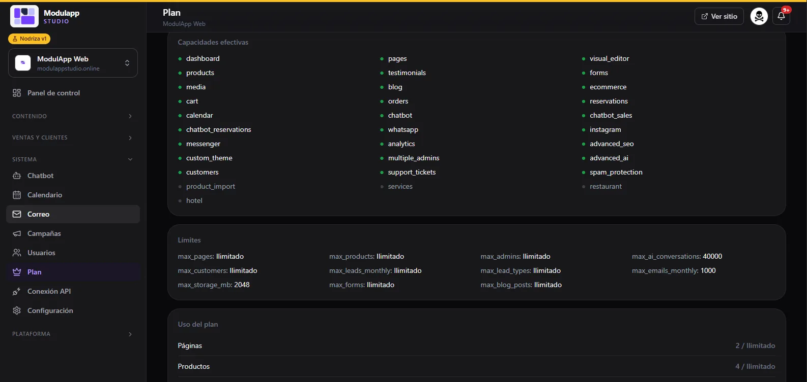

import { Aside } from '@astrojs/starlight/components';

En **Sistema → Plan** ves qué puedes usar en tu sitio y cuánto llevas consumido.

## Capacidades efectivas

Es la lista de módulos de la plataforma. Los que aparecen **en verde están incluidos** en tu plan; los **grises no lo están**. Entre los incluidos hay, por ejemplo: panel de control, páginas, productos, testimonios, blog, media, pedidos, carrito, editor visual, formularios, tienda, reservas, calendario, chatbot con reservas y ventas, WhatsApp, Instagram, Messenger, analítica, SEO avanzado, IA avanzada, clientes, tickets de soporte y protección contra spam.

<Aside type="note">
Los nombres aparecen en inglés técnico (`visual_editor`, `chatbot_sales`…). Se muestran así en el panel.
</Aside>

## Límites

Los topes de tu plan. En el ejemplo de la captura:

| Límite | Qué mide | Valor del ejemplo |
|---|---|---|
| `max_pages`, `max_products`, `max_admins`, `max_customers`, `max_forms`, `max_blog_posts` | Páginas, productos, administradores, clientes, formularios y artículos de blog | Ilimitado |
| `max_leads_monthly`, `max_lead_types` | Contactos recibidos al mes y tipos de formulario de contactos | Ilimitado |
| `max_ai_conversations` | Conversaciones con IA | 40.000 |
| `max_emails_monthly` | Correos enviados al mes | 1.000 |
| `max_storage_mb` | Almacenamiento de imágenes (Media) | 2.048 MB (2 GB) |

Los valores dependen de tu plan.

## Uso del plan

Más abajo, **Uso del plan** compara lo que tienes con tu límite (por ejemplo, «Páginas 2 / Ilimitado»). Es la misma información que muestran las barras del [Panel de control](/primeros-pasos/panel-de-control/).
