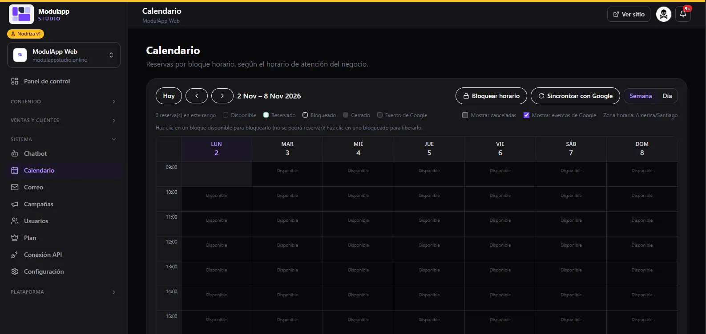

import { Aside } from '@astrojs/starlight/components';

En **Sistema → Calendario** ves las reservas por **bloque horario**, según el horario de atención de tu negocio.

## Moverte por el calendario

- **Hoy** vuelve a la fecha actual y las flechas cambian de semana.
- **Semana** y **Día** cambian la vista.
- La **zona horaria** que se usa aparece arriba a la derecha.

## Estados de cada bloque

Cada bloque de una hora tiene un estado, indicado por la leyenda de arriba:

| Estado | Significado |
|---|---|
| **Disponible** | Se puede reservar. |
| **Reservado** | Ya tiene una reserva. |
| **Bloqueado** | Lo bloqueaste tú: nadie puede reservarlo. |
| **Cerrado** | Fuera del horario de atención. |
| **Evento de Google** | Viene de tu Google Calendar. |

Marca **Mostrar canceladas** para ver también las reservas canceladas, y **Mostrar eventos de Google** para ver los eventos de tu calendario de Google.

## Bloquear y liberar horas

- Haz clic en un bloque **disponible** para **bloquearlo**: no se podrá reservar.
- Haz clic en un bloque **bloqueado** para **liberarlo**.
- **Bloquear horario** te ayuda a cerrar varias horas de una vez.

## Sincronizar con Google

**Sincronizar con Google** trae tus eventos y envía las reservas a tu Google Calendar. Para activarlo, configura la conexión en [Chatbot → Google Calendar](/sistema/chatbot/).

<Aside type="tip">
Las reservas llegan al calendario desde el [Chatbot](/sistema/chatbot/) y desde los [formularios](/ventas/formularios/) de reserva.
</Aside>
