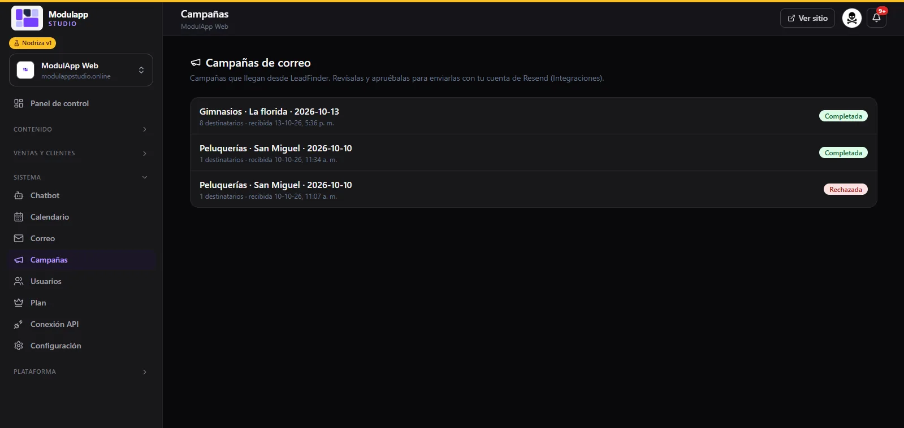

import { Aside } from '@astrojs/starlight/components';

**Sistema → Campañas** reúne las **campañas de correo que llegan desde LeadFinder**, la herramienta que busca negocios y prepara los mensajes. Tú las revisas y las apruebas para enviarlas con tu propia cuenta de Resend.

## Qué muestra la lista

Cada campaña indica:

- Su **nombre**: normalmente el rubro, la zona y la fecha (por ejemplo, «Gimnasios · La Florida · 2026-10-13»).
- El número de **destinatarios** y cuándo se recibió.
- Su **estado**: **Completada** si ya se envió, o **Rechazada** si no la aprobaste.

## El flujo completo

1. En LeadFinder buscas negocios de un rubro y una zona, y preparas la campaña.
2. La campaña llega aquí, a tu panel.
3. Tú la **revisas y la apruebas** (o la rechazas). Nada se envía sin tu aprobación.
4. Al aprobarla, se envía con tu cuenta de Resend.

<Aside type="caution">
Antes de enviar correos a personas que no te conocen, revisa que cumplas con la normativa de protección de datos y que cada correo incluya una forma clara de dejar de recibirlos.
</Aside>

Para que el envío funcione, conecta tu cuenta en [Configuración → Integraciones](/sistema/configuracion/).
