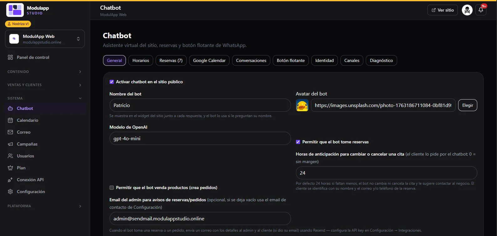
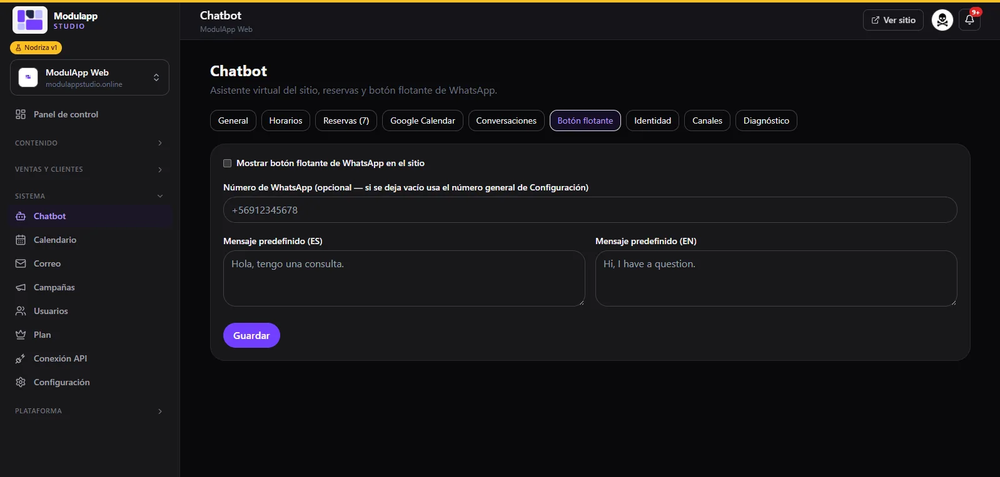

import { Aside } from '@astrojs/starlight/components';

El chatbot es el **asistente virtual de tu sitio**. Atiende a tus visitantes, puede tomar reservas y, si lo activas, crear pedidos. Lo configuras en **Sistema → Chatbot**.

Arriba verás las pestañas: **General, Horarios, Reservas, Google Calendar, Conversaciones, Botón flotante, Identidad, Canales y Diagnóstico**.

## General

| Opción | Para qué sirve |
|---|---|
| **Activar chatbot en el sitio público** | Muestra u oculta el chat en tu sitio. |
| **Nombre del bot** | El nombre que ven tus visitantes junto a cada respuesta. |
| **Avatar del bot** | La imagen del asistente. Pega una dirección o pulsa **Elegir**. |
| **Modelo de OpenAI** | El modelo de IA que responde. |
| **Permitir que el bot tome reservas** | El asistente puede agendar citas. |
| **Horas de anticipación** | Cuántas horas antes puede un cliente cambiar o cancelar una cita desde el chat (por defecto 24; `0` = sin margen). |
| **Permitir que el bot venda productos** | El asistente puede crear pedidos. |
| **Email del admin para avisos** | Dónde te llegan los avisos de reservas y pedidos. Si lo dejas vacío, usa el correo de contacto de Configuración. |

## Reservas

Lista todas las reservas que ha tomado el chatbot, con fecha, hora, contacto y su estado (**Pendiente**, **Completada**…). Las reservas sincronizadas aparecen marcadas como **Sincronizada con Google Calendar**.

## Google Calendar

Sincroniza las reservas con tu Google Calendar.

1. Marca **Activar sincronización con Google Calendar**.
2. Pega el **ID del calendario**.
3. Pega el **JSON de la cuenta de servicio de Google**.
4. **Comparte tu calendario** con el correo de esa cuenta de servicio, con el permiso «Hacer cambios en eventos».
5. Pulsa **Guardar** y luego **Probar conexión**. Verás «Conectado a…» si todo está bien.

<Aside type="caution">
El JSON de la cuenta de servicio se guarda solo en el panel y nunca se envía al sitio público. No lo compartas con nadie.
</Aside>

La opción **Enviar correo al cliente** agrega al cliente como invitado del evento (con recordatorio de 10 minutos) y le manda un correo de confirmación. Desactívala mientras haces pruebas para no avisarle a nadie real.

## Conversaciones

Aquí ves cada conversación de tus visitantes. Ábrela para leer los mensajes. Desde ahí puedes:

- Activar o desactivar las **Respuestas automáticas (IA)** en esa conversación.
- **Convertir en cliente** a la persona: agrega su nombre y correo y queda registrada en tu lista de clientes.

## Botón flotante de WhatsApp

1. Marca **Mostrar botón flotante de WhatsApp en el sitio**.
2. Escribe el **número de WhatsApp** con código de país (por ejemplo `+56912345678`). Si lo dejas vacío, usa el número general de Configuración.
3. Escribe el **mensaje predefinido** en español e inglés.
4. Pulsa **Guardar**.

<Aside type="note">
Las pestañas Horarios, Identidad, Canales y Diagnóstico se documentarán en una próxima versión.
</Aside>
