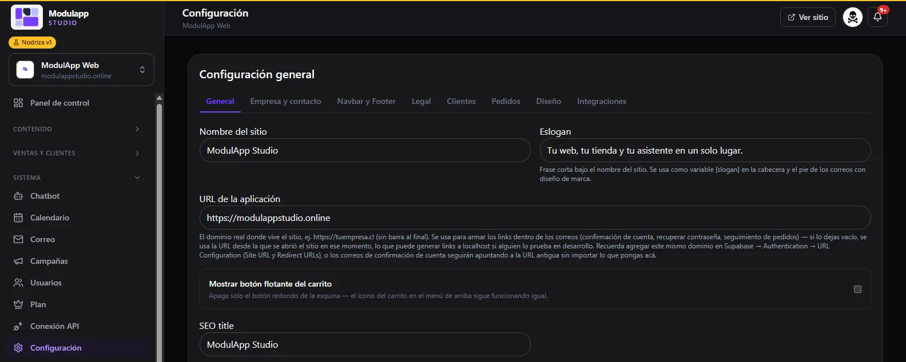
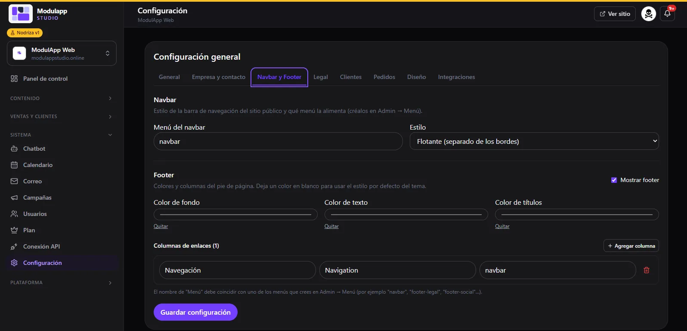
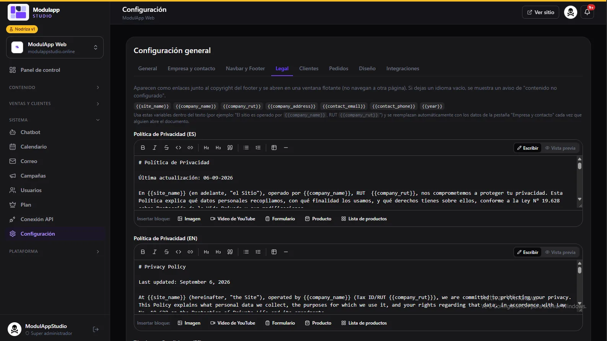
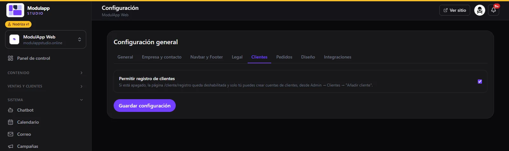
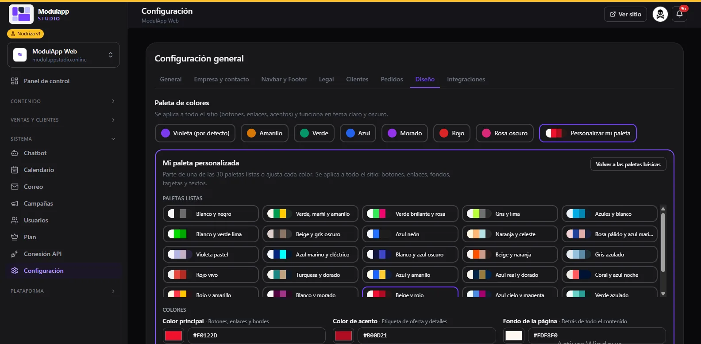

import { Aside } from '@astrojs/starlight/components';

En **Sistema → Configuración** dejas tu sitio a tu medida. Se organiza en pestañas: **General, Empresa y contacto, Navbar y Footer, Legal, Clientes, Pedidos, Diseño** e **Integraciones**. Recuerda pulsar **Guardar configuración** al terminar.

## General

- **Nombre del sitio** y **Eslogan**. El eslogan es la frase corta bajo el nombre y también se usa en la cabecera y el pie de tus correos.
- **URL de la aplicación:** el dominio real de tu sitio (por ejemplo `https://tuempresa.cl`, sin barra al final). Se usa para armar los enlaces dentro de los correos.
- **Mostrar botón flotante del carrito:** apaga solo el botón redondo de la esquina; el ícono del carrito del menú sigue funcionando.
- **SEO title** y el resto de datos para buscadores.

## Empresa y contacto

Tu **WhatsApp**, **teléfono** y **correo de contacto**, y los **datos de la empresa** (razón social, RUT y dirección). Estos datos se usan como variables en los textos legales, y también hay un bloque para tus datos de transferencia.

## Navbar y Footer

- **Navbar:** elige qué menú alimenta la barra superior (los creas en [Menú](/contenido/menu/)) y su **estilo**, por ejemplo flotante y separado de los bordes.
- **Footer:** muestra u oculta el pie de página, define los **colores** de fondo, texto y títulos (déjalos en blanco para usar el estilo del tema) y agrega **columnas de enlaces**: cada una con un nombre en español e inglés y el menú que muestra.

## Legal

Aquí escribes tu **Política de Privacidad** y tus **Términos y Condiciones**, en español e inglés. Aparecen como enlaces junto al copyright y se abren en una ventana flotante.

Los textos se escriben con un editor sencillo (Markdown) y aceptan **variables** que se reemplazan solas con los datos de tu empresa: `{{site_name}}`, `{{company_name}}`, `{{company_rut}}`, `{{company_address}}`, `{{contact_email}}`, `{{contact_phone}}` y `{{year}}`. También puedes insertar bloques de imagen, video de YouTube, formulario, producto o lista de productos.

<Aside type="caution">
Revisa que tus textos legales sean correctos para tu negocio. Los modelos que ofrece el panel son un punto de partida, no asesoría legal.
</Aside>

## Clientes

**Permitir registro de clientes** activa o desactiva el registro en tu sitio. Si lo apagas, la página de registro queda deshabilitada y solo tú puedes crear cuentas desde [Clientes](/ventas/clientes/). Ver también el [Portal del cliente](/ventas/portal-del-cliente/).

## Diseño

La **paleta de colores** se aplica a todo el sitio (botones, enlaces, acentos) y funciona en tema claro y oscuro.

- Elige una paleta básica: **Violeta** (por defecto), **Amarillo**, **Verde**, **Azul**, **Morado**, **Rojo** o **Rosa oscuro**.
- O pulsa **Personalizar mi paleta**: parte de una de las 30 paletas listas o ajusta cada color: **principal** (botones, enlaces y bordes), **de acento** (etiquetas de oferta y detalles) y **de fondo**.

## Integraciones

Aquí conectas los servicios externos. Las claves se guardan en un lugar que solo un administrador puede leer y **nunca se muestran en el sitio público**. Si ya hay una guardada, verás «guardada — escribe para reemplazarla».

| Integración | Para qué sirve |
|---|---|
| **Resend API key** y **Email remitente** | Enviar los correos de pedidos, reservas y campañas. El remitente debe estar verificado en tu cuenta de Resend. |
| **Correo entrante (Resend Inbound)** | Recibir en tu bandeja de [Correo](/sistema/correo/) los mensajes que llegan a tus direcciones. |
| **Pexels API key** | Opcional: buscar fotos desde el [blog](/contenido/blog/). |

<Aside type="note">
La inteligencia artificial (OpenAI) la provee la plataforma: **no necesitas configurar tu propia clave**.
</Aside>

La pestaña **Pedidos** se documentará en una próxima versión.
