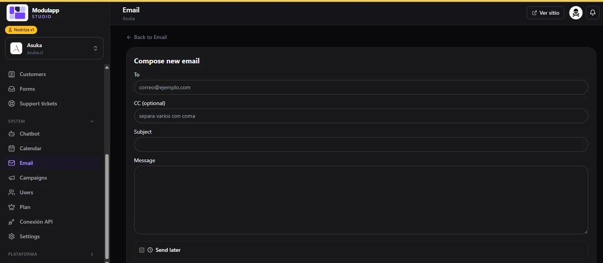

import { Aside, Steps } from '@astrojs/starlight/components';

En **Sistema → Correo** manejas el correo de tu negocio sin salir del panel. Funciona con **Resend**: los correos que llegan a tus direcciones aparecen en tu bandeja.

Las pestañas son **Recibidos**, **Enviados**, **Programados**, **Eliminados** y **Settings**.

## Recibidos y enviados

- **Recibidos** lista los correos con remitente, asunto, una vista previa y la fecha. El punto morado marca los que no has leído y la papelera elimina un correo. El botón de actualizar vuelve a cargar la bandeja.
- **Enviados** muestra lo que has mandado, con destinatario, asunto y fecha.
- **Programados** son los que dejaste para enviar más tarde.

## Redactar un correo

<Steps>

1. Pulsa **Compose new email** (Redactar), arriba a la derecha.
2. Escribe el destinatario en **To (Para)**. Puedes agregar **CC** (opcional); separa varias direcciones con coma.
3. Completa **Subject (Asunto)** y **Message (Mensaje)**.
4. Si quieres enviarlo después, marca **Send later (Enviar más tarde)** y elige cuándo.
5. Envía el correo.

</Steps>

<Aside type="note">
En el panel actual esta sección aparece en inglés (*Received*, *Sent*, *Compose new email*…). Los pasos son los mismos.
</Aside>

## Correos automáticos (Settings)

La pestaña **Settings** personaliza los correos que el sistema envía solo. Puedes escribir el contenido en HTML e insertar imágenes (logo, encabezado) desde [Media](/contenido/media/).

**Diseño de marca.** El interruptor **Usar el diseño HTML de marca en los correos** envuelve cada correo en un encabezado y un pie con tu estilo. Si algo sale mal, apágalo para enviar correos simples, sin diseño.

**Imagen de cabecera.** Opcional: se agrega arriba de todos los correos.

Hay un cuadro para cada tipo de correo, con **asunto**, **mensaje (HTML)** y **vista previa**:

| Correo | Cuándo se envía |
|---|---|
| **Seguimiento** | Cuando el pedido pasa a «en preparación». Incluye el número de cliente y un enlace para ver el estado. |
| **Agradecimiento** | Cuando el pedido se marca como completado. Puede incluir un enlace, por ejemplo para dejar una reseña en Google. |
| **Pedido pagado** | Cuando se confirma un pago por Webpay, PayPal o TUU, con los administradores en copia. |

### Variables

Dentro del asunto y del mensaje puedes usar estas variables, que se reemplazan solas:

| Variable | Qué pone |
|---|---|
| `{{customer_name}}` | Nombre del cliente. |
| `{{customer_number}}` | Número de cliente. |
| `{{tracking_code}}` | Código de seguimiento del pedido. |
| `{{link}}` | El enlace configurado, o el de seguimiento del pedido si lo dejas vacío. |
| `{{shipping_link}}` | El enlace del courier; se completa al guardar el número de seguimiento en [Pedidos](/ventas/pedidos/). |
| `{{site_name}}` | Nombre de tu sitio. |

<Aside type="tip">
Escribe primero el texto y revisa siempre la **vista previa**, que muestra cómo lo verá tu cliente.
</Aside>

La cuenta de Resend y el correo remitente se configuran en [Configuración → Integraciones](/sistema/configuracion/).
