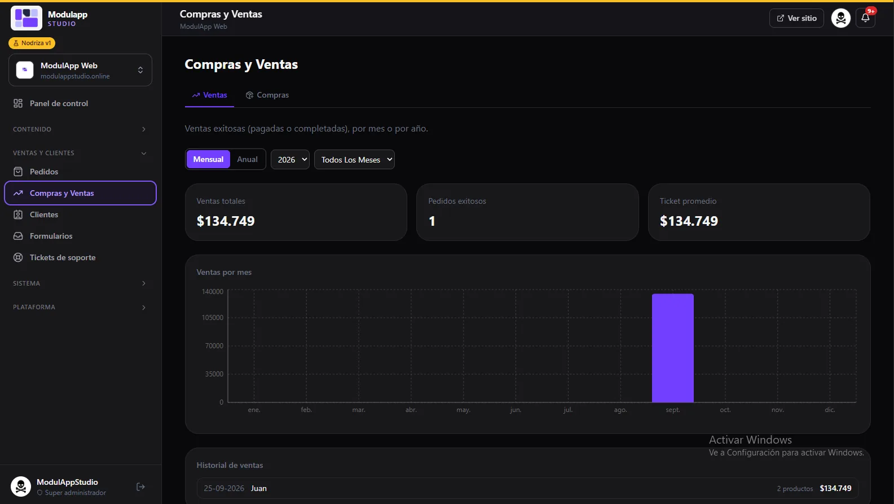
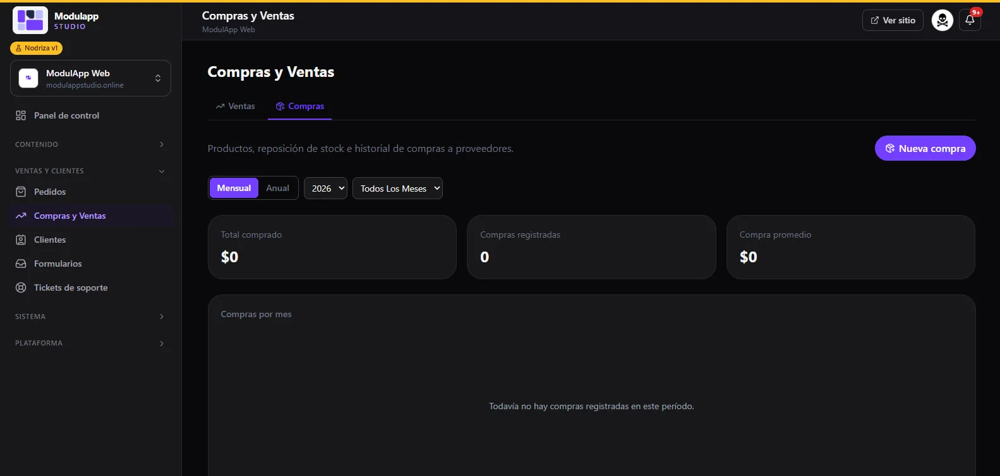

import { Aside } from '@astrojs/starlight/components';

**Ventas y clientes → Compras y Ventas** reúne el dinero que entra y el que sale. Tiene dos pestañas: **Ventas** y **Compras**.

## Ventas

Muestra las **ventas exitosas** (pagadas o completadas).

- Elige la vista **Mensual** o **Anual**, el año y el mes.
- Tres tarjetas resumen el periodo: **Ventas totales**, **Pedidos exitosos** y **Ticket promedio**.
- El gráfico **Ventas por mes** muestra cuánto vendiste cada mes.
- El **Historial de ventas** lista cada venta con su fecha, cliente, cantidad de productos y monto.

## Compras

Aquí llevas el control de la **reposición de stock** y de lo que le compras a tus proveedores.

- Pulsa **Nueva compra** para registrar una.
- Tres tarjetas muestran el **Total comprado**, las **Compras registradas** y la **Compra promedio**.
- El gráfico **Compras por mes** y el historial se llenan a medida que registras compras. Si no hay ninguna en el periodo, verás «Todavía no hay compras registradas en este período».

<Aside type="tip">
Registrar tus compras te permite ver cuánto entra y cuánto sale en el mismo lugar. Los últimos movimientos de ambas pestañas también aparecen en el [Panel de control](/primeros-pasos/panel-de-control/).
</Aside>
