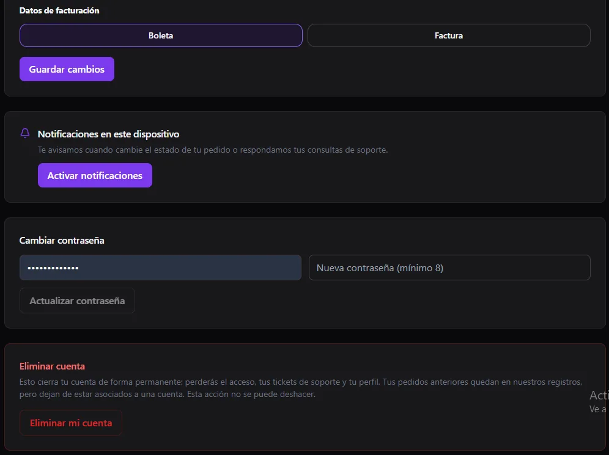

import { Aside } from '@astrojs/starlight/components';

Tus clientes pueden tener **su propia cuenta en tu sitio**. Ahí revisan sus pedidos y su estado, y gestionan sus datos. Esta página explica qué ven ellos.

<Aside type="note">
El portal vive en tu sitio público, no en el panel. Ver [Clientes](/ventas/clientes/) para administrarlos desde el panel.
</Aside>

## Mi cuenta

Al iniciar sesión, el cliente entra a **Mi cuenta**, con estas pestañas: **Mi perfil**, **Mis pedidos**, **Pedidos del local**, **Mis citas**, **Mis formularios** y **Soporte**.

### Mi perfil

- **Nombre completo**, **correo** (no se puede cambiar) y **teléfono**.
- **Datos de envío:** dirección, comuna, ciudad y notas de despacho. Se usan para completar solos sus próximos pedidos cuando compra con la sesión iniciada.
- **Datos de facturación:** elige **Boleta** o **Factura**.

### Notificaciones

Con **Activar notificaciones**, el cliente recibe un aviso en su dispositivo cuando cambia el estado de su pedido o cuando responden una consulta de soporte.

### Contraseña y cuenta

- **Cambiar contraseña:** pide la contraseña actual y una nueva de **al menos 8 caracteres**.
- **Eliminar mi cuenta:** es **permanente**. Pierde el acceso, sus tickets y su perfil. Los pedidos anteriores quedan en tus registros, pero ya sin una cuenta asociada.

## Seguimiento de un pedido

Cada pedido tiene una página de seguimiento con su estado. Si tú cargas el número del courier en [Pedidos](/ventas/pedidos/), el cliente también recibe el enlace en su correo.

## Que se registren o no

En [Configuración → Clientes](/sistema/configuracion/) puedes **permitir o no el registro** de clientes. Si lo apagas, la página de registro queda deshabilitada y solo tú puedes crear cuentas, desde [Clientes](/ventas/clientes/).
